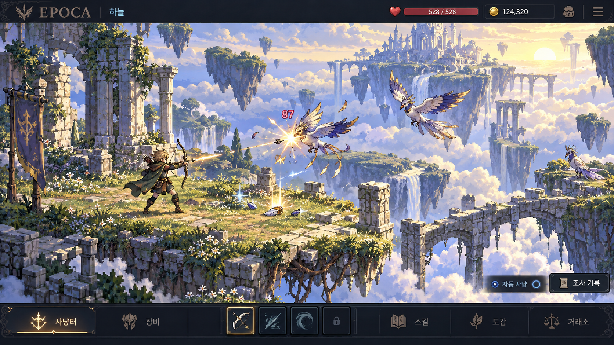
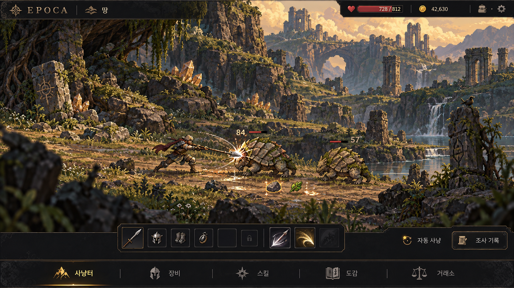
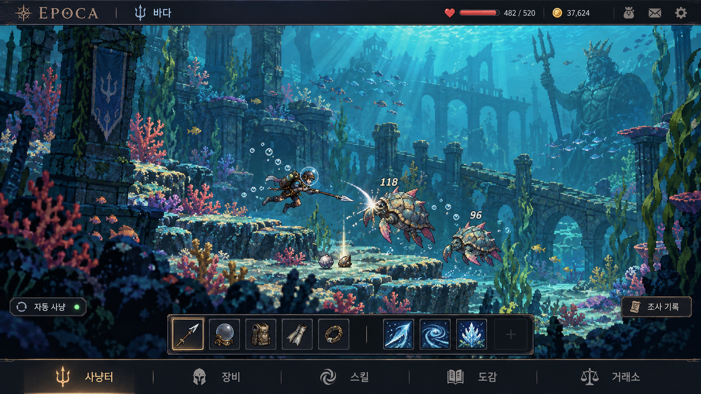

# 플레이 화면 목업

상태: 초안

## 목적과 근거

[게임 설계](design.md)의 자동 사냥·장비와 스킬 구성·지역 선택·도감·거래를 하늘·땅·바다 세 권역의 플레이 화면으로 표현한다. 2026-10-07에 사용자 요청으로 권역별 이미지 한 장씩 생성했다. 고품질 픽셀 아트 방향을 탐색하며 실제 게임 구현이나 스프라이트 생성 실험의 결과를 나타내지 않는다.

## 권역별 제안

세계 구분의 순서인 하늘·땅·바다에 따라 제시한다. 아래 환경·생물·장비는 목업용 제안이다.

| 권역 | 환경 | 사냥 장면 |
| --- | --- | --- |
| 하늘 | 부유섬·구름·공중 유적 | 활을 사용하는 모험가와 비행 생물 |
| 땅 | 암석 분지·광물·지상 유적 | 창을 사용하는 모험가와 판갑형 생물 |
| 바다 | 산호 지형·수중 유적 | 잠수 장비를 사용하는 모험가와 수생 생물 |

## 생성 기록과 한계

내장 `image_gen.imagegen`으로 참조 이미지 없이 권역별 1회씩 생성했다. 실제 전달한 지침은 [생성 기록](../assets/play-screen/generation.json)에 보존한다. 정확한 모델 식별자와 시드는 도구에서 제공하지 않았다. 이전 에셋이나 생성 이미지를 참조 입력으로 전달하지 않았다.

기본 메뉴 문구·권역 구분·전투 중심 구성을 확인했다. 이미지마다 UI 배치·아이콘·표시 수치가 다르므로 확정된 공통 UI로 사용하지 않는다. 픽셀 격자·팔레트·스프라이트 분리·동작·성능은 검증하지 않았다. 적응에 따른 외형 차이의 인지 가능성도 별도 검증이 필요하다.

## 다음 결정

화면 비율·카메라·캐릭터 표시 크기·UI 배치를 사용자와 결정한다. 구체적인 생물과 사냥터, 잠수 장비와 이동 방식은 게임 규칙으로 채택하기 전에 검토한다. 목업에 표시한 체력·화폐·피해 수치는 예시이며 밸런스 기준으로 사용하지 않는다.
